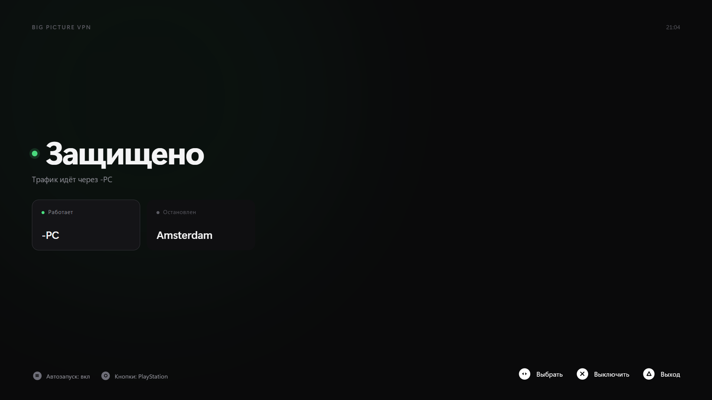

# Big Picture VPN



Приложение для Steam Big Picture, которое включает и выключает AmneziaWG VPN
с геймпада — Xbox или PS4/PS5. Без единого запроса UAC: он появляется на
рабочем столе позади полноэкранного режима, и нажать в нём что-либо с геймпада
невозможно.

## Требования

- Windows 10/11
- Клиент AmneziaWG в `C:\Program Files\AmneziaWG\` и хотя бы один рабочий конфиг
- Для сборки: Node.js, Rust (msvc), C++ build tools, WebView2

## Установка

Один раз, от имени администратора:

```bash
powershell -NoProfile -ExecutionPolicy Bypass -File scripts\setup-scheduled-task.ps1
```

Скрипт ставит помощника в `C:\Program Files\BigPictureVPN` и регистрирует
задачу `BigPictureVPN-Control`, работающую от имени SYSTEM. Приложение
обращается к ней, когда своих прав не хватает.

Задача обязательна. AmneziaWG при выключении туннеля **удаляет** его службу, а
не останавливает, поэтому включение с нуля означает создание службы заново — а
это требует прав администратора. Каталог конфигов тоже закрыт для обычного
пользователя, так что и список туннелей приложение получает через задачу.

Необязательно: `setup-tunnels.ps1` выдаёт прямые права на существующие службы —
тогда переключение идёт быстрее, а задача остаётся страховкой. Откат —
`setup-tunnels.ps1 -Revoke`.

Затем добавь `BigPictureVPN.exe` в Steam как стороннюю игру и включи **Ввод
Steam** в свойствах игры. Оформление для библиотеки лежит в
[`assets/steam/`](assets/steam/).

## Управление

| Геймпад | Клавиатура | Действие |
|---|---|---|
| ← →, любой стик | ← → | Перевести выделение по списку |
| A / ✕ | Enter, Пробел | Подключить выделенный или выключить, если он уже работает |
| Start | — | Автозапуск VPN при старте приложения |
| B / ○ | — | Схема кнопок: Xbox ↔ PlayStation |
| Y / △ (удержать 2 с) | Esc (удержать) | Выход |

Выделение и подключение разделены: перебирать список можно сколько угодно,
соединение при этом не трогается. Подпись кнопки показывает, что именно
произойдёт. Если новый конфиг не подключился, приложение вернёт предыдущий.

Схема кнопок переключается вручную: под Steam Input любой контроллер, включая
DualSense, представляется приложению как Xbox 360, так что определить его тип
автоматически нечем. Chromium показывает геймпад странице только после первого
нажатия кнопки — поэтому приложение может попросить нажать любую кнопку.

## Разработка и сборка

```bash
npm install
npm run tauri dev     # окно обычное, в релизе — полноэкранное
npm run tauri build
```

Иконка генерируется из `assets/app-icon-1024.png` через
`npx tauri icon`. После её смены нужно тронуть `src-tauri/build.rs`, иначе
Cargo не пересоберёт ресурс и exe молча уйдёт со старой иконкой.

## Скрипты

| Скрипт | Назначение |
|---|---|
| `setup-scheduled-task.ps1` | Основная установка: помощник + задача от SYSTEM. Есть `-Remove` |
| `tunnel-control.ps1` | Привилегированный помощник, запускается только задачей |
| `setup-tunnels.ps1` | Необязательно: прямые права на службы. Есть `-Activate` и `-Revoke` |
| `test-vpn-toggle.ps1` | Проверка переключения с гарантированным восстановлением туннеля |
| `list-tunnels.ps1` | Инвентаризация конфигов и служб, только чтение |

Правка `tunnel-control.ps1` не действует, пока не запущен
`setup-scheduled-task.ps1`: задача работает с копией в `Program Files`, куда
обычный пользователь писать не может.

## Если перестало работать

**Список туннелей пуст** — проверь задачу: `Get-ScheduledTask BigPictureVPN-Control`.
Нет — запусти `setup-scheduled-task.ps1` от администратора.

**Туннель не включается** — смотри журнал
`%ProgramData%\BigPictureVPN\control.log`.

**Туннель включается и сразу пропадает** — это не приложение: AmneziaWG удаляет
службу конфига, который не может подключиться. Проверь конфиг в самом AmneziaWG.

## Лицензия

MIT — см. [LICENSE](LICENSE).
