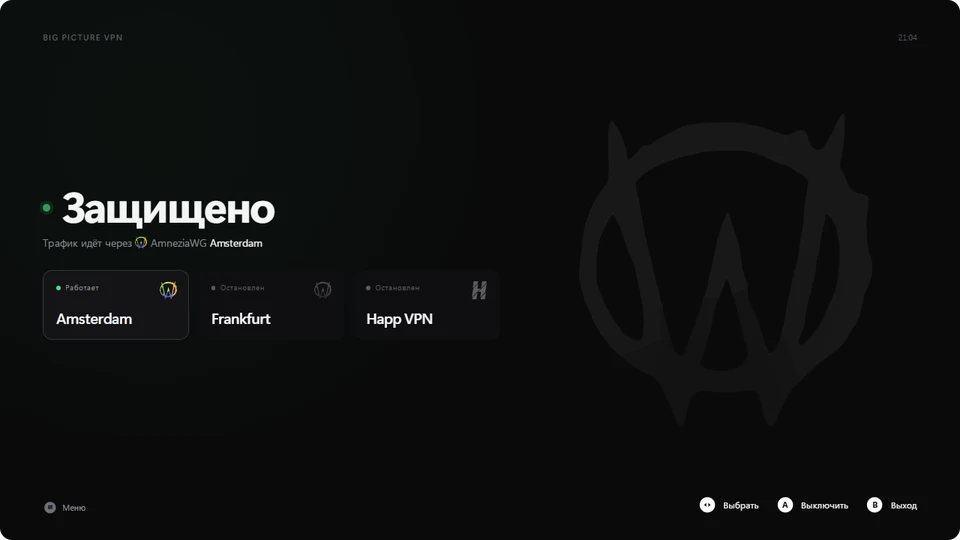

<h1 align="center">Big Picture VPN</h1>

<p align="center">
  
</p>

Включает и выключает VPN прямо в Steam Big Picture, с геймпада Xbox или
PS4/PS5. Окно VPN-клиента и запрос UAC остаются на рабочем столе позади
полноэкранного режима, и геймпадом до них не добраться, а это приложение
обходится без них.

Работает с [AmneziaWG](https://github.com/amnezia-vpn/amneziawg-windows-client)
и [Happ](https://www.happ.su). Интерфейс на русском и английском, язык
определяется по системе.

## Установка

1. Поставь и настрой AmneziaWG или Happ. Для Happ выбери сервер и включи режим TUN.
2. Скачай `Big.Picture.VPN_x.y.z_x64-setup.exe` со
   [страницы релизов](https://github.com/drxid/big-picture-vpn/releases/latest)
   и запусти. Установщик один раз запросит права администратора, потом приложению
   они не нужны.
3. Добавь `C:\Program Files\Big Picture VPN\BigPictureVPN.exe` в Steam как
   стороннюю игру и включи **Ввод Steam** в свойствах. Оформление для библиотеки
   лежит в [`assets/steam/`](assets/steam/).

## Управление

| Геймпад | Клавиатура | Действие |
|---|---|---|
| ← →, любой стик | ← → | Выбрать туннель |
| A / ✕ | Enter, Пробел | Подключить выбранный или выключить работающий |
| Menu / Options | M | Открыть меню |
| B / ○ | Esc, Backspace | Закрыть меню |
| B / ○ (удержать 2 с) | Esc (удержать) | Выйти |

В меню можно выбрать, что показывать первым, включить автозапуск VPN, сменить
схему кнопок Xbox ↔ PlayStation и язык.

Активен всегда один VPN: при подключении остальные выключаются, а если новый
туннель не поднялся, приложение вернёт предыдущий.

У Happ в списке одна карточка: она подключает сервер, выбранный в самом Happ.
Если Happ не запущен, приложение запустит его свёрнутым в трей. Не закрывай его,
пока нужен VPN: туннель работает вместе с ним.

## Если что-то не работает

**Нет туннелей AmneziaWG.** Переустанови приложение: так восстановится служебная
задача `BigPictureVPN-Control`. Её журнал лежит в
`%ProgramData%\BigPictureVPN\control.log`.

**Туннель включается и сразу пропадает.** AmneziaWG удаляет службу конфига,
который не может подключиться. Проверь конфиг в самом AmneziaWG.

**Happ не подключается.** Нужен режим TUN: в режиме системного прокси приложение
не видит подключения. Команды управления Happ не документированы и проверены на
версии 4.6.1, новые версии могут их изменить.

## Сборка

Нужны Node.js, Rust (msvc), C++ build tools и WebView2.

```bash
npm install
npm run tauri dev
npm run tauri build
```

Релиз собирается автоматически по тегу `v*`: GitHub Actions создаёт черновик с
установщиком.

## Лицензия

MIT, см. [LICENSE](LICENSE).
